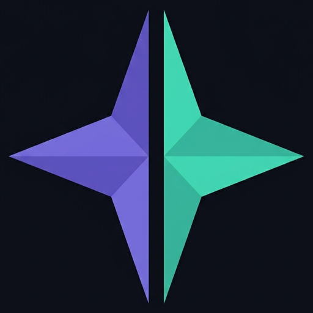

# ⚡ Stella AI — Personal AI Assistant

### *An adaptive, self-improving AI companion that molds to your workflow, voice, and daily needs.*

---

## 🌌 Overview

**Stella AI** is a modular, self-evolving personal AI assistant. It runs a Python backend with a Next.js frontend and a Termux Android companion. Users choose their LLM provider during onboarding (Gemini Live, OpenAI-compatible, Anthropic, OpenRouter, Groq, Ollama, LM Studio, or custom). Stella includes built-in actions, drop-in plugins, packaged skills (110+), and a Dr. Zero-inspired self-evolution system that trains and improves without training data dumps.

---

## 🏗️ Architecture

\`
Stella/
├── main.py                     # Python backend entry point (WebSocket IPC server on :8765)
├── requirements/               # Python dependency groups
├── scripts/                    # Build, start, and utility scripts
│   ├── start-all.js            # Unified launcher: starts backend + frontend together
│   ├── start-stella.bat        # Windows launcher for all endpoints
│   └── bootstrap.ps1           # Dependency bootstrap
├── frontend/                   # Next.js frontend (port 3000)
├── src/backend/                # Python backend core
│   ├── agent/                  # Agentic runtime (loop, planner, executor, tools)
│   │   ├── loop.py             # Think→act→observe→verify loop
│   │   ├── planner.py          # Task planner (JSON tool steps)
│   │   ├── executor.py         # AgentExecutor (all layers dispatch)
│   │   ├── tools.py            # Tool dataclass, Registry, built-in tools
│   │   ├── skill_loader.py     # Loads skills from skills/
│   │   ├── integration.py      # Bridge UI/voice → agent loop
│   │   └── evolution/          # Dr. Zero self-evolution (NEW)
│   │       ├── proposer.py     # Generates diverse questions
│   │       ├── solver.py       # Attempts questions using agent tools
│   │       ├── curriculum.py   # Automated difficulty curriculum
│   │       ├── hrpo.py         # Hop-grouped relative policy optimization
│   │       └── engine.py       # Evolution loop orchestrator
│   ├── core/                   # Engine, config, memory, theme tokens
│   ├── integrations/           # CRM, newsletter, jobs, business dir, events
│   └── starnet/                # Multi-agent crew, skills catalog, budget/consent, cron
├── skills/                     # 110+ packaged skills (SKILL.md + skill.py)
├── themes.json                 # Single source of truth for all themes (incl. Solar)
├── LICENSE
├── README.md
├── CODE_OF_CONDUCT.md
├── CONTRIBUTING.md
├── SECURITY.md
└── TRADEMARK.md
\

---

## 🎯 Features

- **Real-time voice & text chat** with streaming speech synthesis (Leokani-TTS small model, 7M params)
- **Wake word activation** ("hey stella")
- **Device control** — volume, brightness, flashlight, Wi-Fi, Bluetooth, DND, timers, reminders
- **Screen context** — attach and analyze your current screen
- **Device linking** — peer-to-peer device mesh across desktop and Android
- **110+ skills** — currency exchange, country info, CVE lookup, forex, news, weather, market data, CRM, habit tracker, and more
- **Themes** — Void, OLED, Nebula, Light, Solar Flare (and more)
- **Self-evolution** — Dr. Zero-inspired system (proposer → solver → curriculum → HRPO)
- **Android companion** 📱 Termux app running Python backend via local WebSocket

---

## 🧠 Self-Evolution (Dr. Zero)

Stella includes a Dr. Zero-inspired self-evolution system that trains and improves without training data:

- **Proposer** — Generates diverse, challenging-yet-solvable questions from domain templates
- **Solver** — Stella's own agent attempts each question using available tools
- **Curriculum** — Automated difficulty adjustment based on solver success rate
- **HRPO** — Hop-Grouped Relative Policy Optimization for efficient evaluation

The engine runs in the background: \propose → solve → evaluate → adjust difficulty → repeat\. Zero training data required.

---

## 🔌 Provider Selection

Users choose their LLM provider during onboarding. The choice is stored in \config/api_keys.json\:

- **Gemini Live** (default) — Native audio conversation
- **OpenAI-compatible** — Any \/v1/chat/completions\ endpoint
- **Anthropic** — Claude models
- **OpenRouter** — Multiple models via one key
- **Groq** — Fast inference
- **Ollama / LM Studio** — Local models
- **Custom** — User-defined endpoint

K2 models are **not bundled**. If you want K2 Horizon or other K2 models, download them yourself via the download hub in Settings.

---

## 🚀 Quick Start

### Prerequisites
- Python 3.11+
- Node.js 18+ (for Next.js frontend)
- A Google Gemini API key (or another provider key)

### Backend + Frontend (Unified Launcher)

\\\powershell
# Clone the repository
git clone https://github.com/Emma-Keaton/stella.git
cd stella

# Create and activate venv
python -m venv .venv
.\.venv\Scripts\Activate.ps1

# Install dependencies
pip install -r requirements.txt

# Start all endpoints together (backend + frontend)
node scripts/start-all.js
# or
scripts\start-stella.bat
\\\

The unified launcher starts:
- **Backend WebSocket:** \ws://localhost:8765\
- **Frontend dev server:** \http://localhost:3000\

Press **Ctrl+C** to shut down all endpoints.

### Android (Termux + WebView)

The Android app runs the Python backend directly on your device via Termux. It connects to the backend WebSocket at `ws://127.0.0.1:8765` locally — no external server, no Modal, no cloud required.

**Install on Android device:**

1. Install **Termux** (F-Droid or Google Play)
2. Run setup: `curl -sSL https://raw.githubusercontent.com/Emma-Keaton/stella/master/termux/setup_stella.sh | bash`
3. Copy backend files: `main.py` and `src/` to `~/stella/`
4. Copy GGUF models (optional): `*.gguf` to `~/stella/models/`
5. Start backend: `./termux/start_stella.sh`
6. Open the Stella Android app — it auto-launches the backend and connects

**Termux scripts:**
- `setup_stella.sh` — Install Python + dependencies + llama servers
- `start_stella.sh` — Start backend persistently (WebSocket :8765)
- `stop_stella.sh` — Stop backend + watcher
- `status.sh` — Check backend health
- `watcher.sh` — Auto-restart backend on crash (persistent uptime)

**API Keys:** Configure via Stella App Settings > Providers (stored in `~/stella/config/api_keys.json`)

**Local Models:** Place GGUF models in `~/stella/models/`. The frontend Download Hub (Settings > Local GGUF Model) lets you download models from URLs with progress tracking.

---

## 📱 Android Companion (Stella Connect)

The Android app runs the Python backend directly on your device via Termux. It connects to the backend WebSocket at ws://127.0.0.1:8765 locally — no external server, no Modal, no cloud required.
equest_id\, \	imestamp\, \payload\). Features:

- Chat with Stella from your phone
- Provider configuration synced from \config/providers.json\
- Encrypted API key storage (Android Keystore)
- Device pairing and command execution
- HUD overlay and widgets

---

## 🎨 Themes

Stella includes multiple themes defined in \	hemes.json\:

- **Void** — Deep void with mint, cyan and violet neon glow (brand default)
- **OLED** — True black for AMOLED savings
- **Nebula** — Purple and violet gradient
- **Light** — Daylight off-white surfaces
- **Solar Flare** — Warm amber, orange, and crimson tones

The solar theme and Leokani-TTS small voice model (7M parameters) are included by default.

## 📥 Download Hub (Local GGUF Models)

Stella's download hub is **device-aware** — it checks your device specs (RAM, storage, CPU) and recommends models that will actually run locally.

**How it works:**

1. **Device Detection:** On load, Stella detects your device's RAM, storage, CPU cores, and whether it's Android
2. **Compatibility Check:** Before downloading any GGUF model, Stella estimates RAM needed (~1.5x model size) and checks available storage
3. **Smart Recommendations:** If your device can't run a model locally, Stella shows cloud provider free-tier suggestions (Groq, OpenRouter, Gemini, OpenAI)
4. **Free Up Space:** If storage is insufficient, Stella gives specific suggestions to free up space (move models to SD card, clear cache, etc.)

**Usage:**
- Paste any GGUF model URL in the download hub (Settings > Local GGUF Model)
- Choose a download destination path (default: `~/stella/models/model.gguf`)
- Watch real-time download progress
- Select the downloaded model to run locally with zero network latency

**Cloud Provider Free Tiers:**
| Provider | Free Tier | Models |
|----------|-----------|--------|
| Groq | 14,400 tokens/min | llama-3.1-8b-instant, llama-3.3-70b-versatile |
| OpenRouter | Free tier for select models | llama-3.2-3b:free, gemma-2-9b-it:free |
| Gemini | Free tier with rate limits | gemini-1.5-flash, gemini-2.0-flash-exp |
| OpenAI | Trial credits for new accounts | gpt-4o-mini, gpt-3.5-turbo |

---

## 📄 License

**Personal & Private Local Use Only — No Distribution.**

This project is licensed under the **Stella AI Source-Available Personal Use License**.

- ✅ **Allowed:** Download, clone, inspect, build, and run locally on your own device for personal, educational, and research use.
- 🚫 **No Distribution:** Do not distribute, redistribute, re-upload, mirror, share, transmit, sublicense, or publish this software anywhere.
- 🚫 **No Commercial Use:** Do not sell, rent, monetize, bundle, or host as a paid SaaS/cloud service.

See [LICENSE](LICENSE) for full terms.

---

<b>Stella AI</b> • Modular • Self-Evolving • Private

