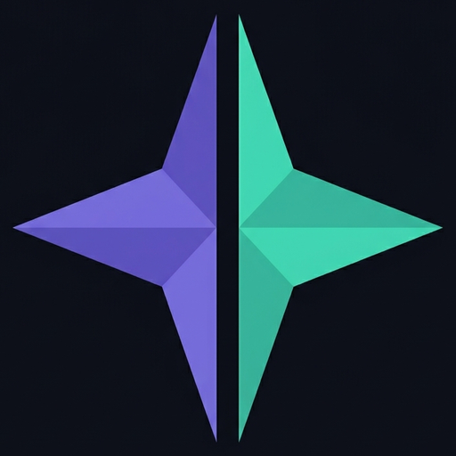

# ⚡ Stella AI — Personal AI Assistant

<div align="center">



### *An adaptive, self-improving AI companion that molds to your workflow, voice, and daily needs.*

[](https://python.org)
[](https://nextjs.org/)
[](https://websockets.org/)
[](https://python.org)
[](https://github.com/Emma-Keaton/stella)

</div>

---

## 🌌 Overview

**Stella AI** is a modular, self-evolving personal AI assistant. It runs a Python backend with a Next.js frontend and the StellaMobile Android companion app. Users choose their LLM provider during onboarding (Gemini Live, OpenAI-compatible, Anthropic, OpenRouter, Groq, Ollama, LM Studio, or custom). Stella includes built-in actions, drop-in plugins, packaged skills (110+), and a Dr. Zero-inspired self-evolution system that trains and improves without training data dumps.

---


## 🎯 Features

- **Real-time voice & text chat** with streaming speech synthesis (Leokani-TTS small model, 7M params)
- **Wake word activation** ("hey stella")
- **Device control** — volume, brightness, flashlight, Wi-Fi, Bluetooth, DND, timers, reminders. Sliders in the Device Settings modal and Device Controls panel send commands over the local WebSocket (ws://localhost:8765) to control the real device.
- **Full device control** — Stella can launch and operate any app or software (keystrokes, typing, mouse clicks), list all running tasks/processes, scan wireless networks, and read battery/CPU/memory — taking full control of the host device.
- **Screen context** — attach and analyze your current screen
- **Device linking** — peer-to-peer device mesh across desktop and Android
- **110+ skills** — currency exchange, country info, CVE lookup, forex, news, weather, market data, CRM, habit tracker, and more
- **Themes** — Void, OLED, Nebula, Light, Solar Flare (and more)
- **Self-evolution** — Dr. Zero-inspired system (proposer → solver → curriculum → HRPO)
- **Android companion** StellaMobile native app (React Native + Kotlin) with on-device Cactus/Needle model

---

## 🧠 Self-Evolution (Dr. Zero)

Stella includes a Dr. Zero-inspired self-evolution system that trains and improves without training data:

- **Proposer** — Generates diverse, challenging-yet-solvable questions from domain templates
- **Solver** — Stella's own agent attempts each question using available tools
- **Curriculum** — Automated difficulty adjustment based on solver success rate
- **HRPO** — Hop-Grouped Relative Policy Optimization for efficient evaluation

The engine runs in the background: \propose → solve → evaluate → adjust difficulty → repeat\. Zero training data required.

---

## 🔌 Provider Selection

Users choose their LLM provider during onboarding. The choice is stored in \config/api_keys.json\:

- **Gemini Live** (default) — Native audio conversation
- **OpenAI-compatible** — Any \/v1/chat/completions\ endpoint
- **Anthropic** — Claude models
- **OpenRouter** — Multiple models via one key
- **Groq** — Fast inference
- **Ollama / LM Studio** — Local models
- **Custom** — User-defined endpoint

K2 models are **not bundled**. If you want K2 Horizon or other K2 models, download them yourself via the download hub in Settings.

---

## 🏗️ Architecture (Paperclip-inspired)

Stella uses a dual-language architecture: Python backend for agent execution and device control, TypeScript packages for shared types, adapters, database, and frontend.

```
Stella/
├── packages/                   # TypeScript packages (shared across frontend, CLI, mobile)
│   ├── stella-types/           # Agent, Skill, Task, Adapter, MCP, ACP types
│   ├── stella-adapters/        # LLM provider adapters (Claude, OpenAI, Gemini, Ollama)
│   ├── stella-db/              # Embedded SQLite database layer
│   ├── stella-skills/          # Skills catalog & execution engine
│   ├── stella-mcp/             # Model Context Protocol client
│   └── stella-acp/             # Agent Client Protocol implementation
├── frontend/                   # Next.js frontend (port 3000)
├── main.py                     # Python backend entry point (WebSocket IPC on :8765)
└── src/backend/                # Python backend core
```

### Core Concepts

| Concept | Description |
|---------|-------------|
| **Agent** | Autonomous LLM-driven worker with model, provider, system prompt, and capabilities |
| **Skill** | Discrete capability (builtin, MCP, Python, TypeScript, ACP) that agents can invoke |
| **Task** | Unit of work assigned to an agent, with input/output and artifact tracking |
| **Artifact** | Output produced by a task (text, code, image, audio, file, JSON, URL) |
| **Team** | Group of agents collaborating on shared objectives |
| **Adapter** | LLM provider adapter (MCP, Claude, Codex, OpenAI, Google, XAI, Ollama, local GGUF) |
| **MCP** | Model Context Protocol server connection for tools and resources |
| **ACP** | Agent Client Protocol for inter-agent and client-to-agent messaging |

### Data Flow

```
User → Frontend (Next.js) → WebSocket (:8765) → Python Backend
                                    ↓
                            Agent → Skill → Tool (MCP/Local)
                                    ↓
                            Artifact → Frontend
```


## 🚀 Quick Start

### Prerequisites
- Python 3.11+
- Node.js 18+ (for Next.js frontend)
- A Google Gemini API key (or another provider key)

### Backend + Frontend (Unified Launcher)

Use the single unified startup script — it checks requirements, installs missing packages (including tiny-tts, pocket-tts, phonon-2), downloads llama.cpp servers, and boots backend + frontend together:

```powershell
# Clone the repository
git clone https://github.com/Emma-Keaton/stella.git
cd stella

# Run the unified launcher (self-elevates to Administrator)
.\scripts\start-stella.ps1
```

The unified launcher starts:
- **Backend WebSocket:** ws://localhost:8765
- **Frontend dev server:** http://localhost:3000

Optional flags:
- `-NoStart` — Setup only, don't start servers
- `-SkipLlama` — Skip llama.cpp server downloads
- `-SkipFrontend` — Skip Node.js frontend
- `-SkipBackend` — Skip Python backend
- `-Dev` — Development mode

Press **Ctrl+C** to shut down all services.

### Android (StellaMobile app)

The StellaMobile app is a native Android companion. Pair it with the desktop backend over the StellaProtocol WebSocket (host/join via QR or pairing code) for PC-mobile and mobile-mobile task handoff — no external server required.

**Install on Android device:**

1. Install the **StellaMobile** APK (see `E:/Projects/stella mobile/StellaMobile`)
2. Open StellaMobile > Device Connect > Host or Join
3. Copy backend files: `main.py` and `src/` to `~/stella/`
4. Copy GGUF models (optional): `*.gguf` to `~/stella/models/`
6. Open the Stella Android app — it auto-launches the backend and connects


**API Keys:** Configure via Stella App Settings > Providers (stored in `~/stella/config/api_keys.json`)

**Local Models:** Place GGUF models in `~/stella/models/`. The frontend Download Hub (Settings > Local GGUF Model) lets you download models from URLs with progress tracking.


---

## 📱 Android Companion (Stella Connect)

StellaMobile pairs with the desktop backend over WebSocket for cross-device control.
equest_id\, \	imestamp\, \payload\). Features:

- Chat with Stella from your phone
- Provider configuration synced from \config/providers.json\
- Encrypted API key storage (Android Keystore)
- Device pairing and command execution
- HUD overlay and widgets

---


## 🖥️ Desktop App (native window, no browser)

Stella ships as a **native desktop app** via [Tauri 2](frontend/src-tauri) — the Next.js UI is
static-exported and loaded in a native WebView window that auto-starts the Python backend
(sidecar) on launch. The frontend talks to it at ws://localhost:8765 as usual.

**Build the installer (Windows):**
```powershell
.\scripts\build-desktop.ps1     # or: cd frontend && npm run desktop:build:win
# output: frontend/src-tauri/target/release/bundle/msi/Stella_*.msi  (installer)
#         frontend/src-tauri/target/release/stella-desktop.exe      (portable)
```
The build: PyInstaller bundles the backend into src-tauri/binaries/stella-backend-<target> (declared
as a Tauri `externalBin` sidecar), `npm run export` static-exports the frontend to frontend/out, and
`tauri build` produces the native app + installer. main.rs spawns the sidecar on launch and kills it on exit.

**Dev mode (native window + hot reload):**
```powershell
cd frontend && npm run desktop:dev    # = tauri dev  (backend falls back to python main.py)
```

**Prereqs for building on Windows:** Rust (rustup), a C linker — either MSVC Build Tools
("Desktop development with C++") or `rustup target add x86_64-pc-windows-gnu` + MinGW — plus
Node.js 18+ and the WebView2 runtime (bundled with Windows 11).

---

## 🎛️ Device Control (WebSocket)

Stella's device settings and quick-controls panels are wired to the backend WebSocket, so moving a slider or toggling a switch
actually controls the device — locally, with no cloud.

**How it works**
- Frontend (`http://localhost:3000`) ↔ Backend WebSocket (`ws://localhost:8765`) both run on your PC.
- The **Device Settings** modal and **Device Controls** panel send `device.command` messages (`volume`, `brightness`, etc.)
  over the WebSocket. The backend executes them on the host device and broadcasts `device.state.changed` so every connected
  frontend's sliders stay in sync with the real device.
- Volume/brightness are verified with read-back (the slider shows the *actual* level, not just what was requested).

**Backend device-control endpoints**
| Endpoint | Action |
|---|---|
| `device.command` | Generic actuator: volume, brightness, notify, launch, keystroke, type, click, network.scan, process.list, process.kill, device.status |
| `device.status` | Snapshot: volume, brightness, battery, CPU, memory, wireless networks |
| `device.processes` | List all running tasks/processes |
| `device.networks` | Scan wireless (Wi-Fi) networks |
| `device.keystroke` / `device.type` / `device.click` | Operate any app/software (hotkeys, typing, mouse clicks) |
| `device.link.execute` | Execute a task on a linked remote device (cross-device task transfer) |

**Device linking / cross-device tasks**
Linked devices register in the device-link graph (`device.link.create` / `device.link.handoff`). Once connected via Stella, users can
defer tasks and execute commands on connected remote devices (`device.link.execute`) — mobile↔mobile, PC↔PC, or PC→mobile — as long as the
target device is online and running Stella.

---

## 💻 Run Fully Local (No Cloud)

Stella is designed to run entirely on your device — backend, WebSocket, and frontend all execute locally on the PC. The core, agent,
loop, skills, and everything else run fully on the device; nothing is required to leave your machine.

**Local stack (default ports)**
- **Backend:** Python WebSocket IPC server on `ws://localhost:8765` (`main.py`)
- **Frontend:** Next.js on `http://localhost:3000`
- **Device control:** Core/agent/loop/skills run on the device and drive volume, brightness, apps, processes, networks, etc.

**Start everything together (local only)**
```powershell
# Windows
cd /d E:\Projects\stella
scripts\start-stella.bat
# or
node scripts/start-all.js
```

```bash
# macOS / Linux
cd /path/to/stella
node scripts/start-all.js
```

Because Stella takes **full control of the device** (operating apps, reading processes/networks, sending keystrokes/clicks), run it with
elevated privileges so device commands succeed:

- **Windows:** Run `scriptsootstrap.ps1` or `start-stella.bat` **as Administrator** (the bootstrap script self-elevates via UAC).
- **macOS:** `sudo python main.py` — also grant Terminal/Python **Accessibility** and **Input Monitoring** in System Settings for keystroke/click control.
- **Linux:** `sudo python main.py` — install `xdotool`, `brightnessctl`, `nmcli`/`iw` for full device control.
- **Android (StellaMobile):** host or join a device session from the Device Connect screen; grant Accessibility + notification permissions.

**Android companion:** StellaMobile connects to the local WebSocket as a linked peer — no external server, no cloud required.

## 🎨 Themes

Stella includes multiple themes defined in \	hemes.json\:

- **Void** — Deep void with mint, cyan and violet neon glow (brand default)
- **OLED** — True black for AMOLED savings
- **Nebula** — Purple and violet gradient
- **Light** — Daylight off-white surfaces
- **Solar Flare** — Warm amber, orange, and crimson tones

The solar theme and Leokani-TTS small voice model (7M parameters) are included by default.

## 🎙️ Voice & TTS

Stella includes an always-on local text-to-speech engine with three tiers:

| Tier | Engine | Voices | Notes |
|------|--------|--------|-------|
| **Primary** | Kokoro-82M (Leokani Dala) | Bella, Sarah, Sky, Aoede, Nicole, Nova, Alloy, Heart, Alicia, Laura | Local, female voices, >100x real-time |
| **Secondary** | Kyutai Pocket TTS | Alba Casual, Alba Clarity | Local, ultra-compact (1.9M params) |
| **Tertiary** | TinyTTS | Tiny Female | Local, edge-optimized (1.6M params) |
| **Fallback** | Microsoft Edge TTS | en-US-AriaNeural | Online, used when local models fail |

Voice models (kokoro-v0_19.onnx + voice .pt files) are downloaded automatically from HuggingFace on first launch and kept resident in `%LOCALAPPDATA%/StellaAI/tts_models/`.

### Voice Selector

The Settings modal includes a voice selector dropdown — choose your preferred female voice. The active voice is saved to `app_settings.json` under the `tts` group (`ttsProvider`, `ttsVoiceId`) and persists across restarts.

## 📥 Download Hub (Local GGUF Models)

Stella's download hub is **device-aware** — it checks your device specs (RAM, storage, CPU) and recommends models that will actually run locally.

**How it works:**

1. **Device Detection:** On load, Stella detects your device's RAM, storage, CPU cores, and whether it's Android
2. **Compatibility Check:** Before downloading any GGUF model, Stella estimates RAM needed (~1.5x model size) and checks available storage
3. **Smart Recommendations:** If your device can't run a model locally, Stella shows cloud provider free-tier suggestions (Groq, OpenRouter, Gemini, OpenAI)
4. **Free Up Space:** If storage is insufficient, Stella gives specific suggestions to free up space (move models to SD card, clear cache, etc.)

**Usage:**
- Paste any GGUF model URL in the download hub (Settings > Local GGUF Model)
- Choose a download destination path (default: `~/stella/models/model.gguf`)
- Watch real-time download progress
- Select the downloaded model to run locally with zero network latency

**Cloud Provider Free Tiers:**
| Provider | Free Tier | Models |
|----------|-----------|--------|
| Groq | 14,400 tokens/min | llama-3.1-8b-instant, llama-3.3-70b-versatile |
| OpenRouter | Free tier for select models | llama-3.2-3b:free, gemma-2-9b-it:free |
| Gemini | Free tier with rate limits | gemini-1.5-flash, gemini-2.0-flash-exp |
| OpenAI | Trial credits for new accounts | gpt-4o-mini, gpt-3.5-turbo |

---


## 📄 License

**Personal & Private Local Use Only — No Distribution.**

This project is licensed under the **Stella AI Source-Available Personal Use License**.

- ✅ **Allowed:** Download, clone, inspect, build, and run locally on your own device for personal, educational, and research use.
- 🚫 **No Distribution:** Do not distribute, redistribute, re-upload, mirror, share, transmit, sublicense, or publish this software anywhere.
- 🚫 **No Commercial Use:** Do not sell, rent, monetize, bundle, or host as a paid SaaS/cloud service.

See [LICENSE](LICENSE) for full terms.

---

<div align="center">
<b>Stella AI</b> • Modular • Self-Evolving • Private
</div>