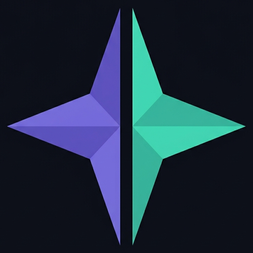

# âš¡ Stella AI Evo — Autonomous Desktop Operating Intelligence

<div align="center">



### *The Self-Evolving, Multimodal Personal AI Desktop Environment*

[](https://python.org)
[](https://riverbankcomputing.com/software/pyqt/)
[](https://ai.google.dev/)
[](https://modelcontextprotocol.io/)
[](https://microsoft.com/windows)

</div>

---

## 🌌 Overview

**Stella AI Evo** is a next-generation desktop intelligence built to function like an authentic JARVIS workstation. Combining real-time bi-directional native voice audio, multimodal computer vision, autonomous code self-evolution, and local system orchestrations, Stella Evo transforms your Windows PC into a self-evolving command center.

> **Heritage.** Stella is the actively-developed successor to this project's earlier name. Existing data migrates automatically: on first launch Stella copies any pre-existing legacy profile (`%LOCALAPPDATA%\<legacy folder>` — settings, memories, credentials) into `%LOCALAPPDATA%\StellaAI`, so nothing is lost in the move. See [Architecture](#️-architecture) for details.

---

## âš¡ What's New in Stella AI Evo

### 1. 🔌 Holographic Hardware Assembler & Circuit HUD
- **Screen & Voice Part Recognition**: Stella scans your screen via computer vision or parses voice commands (`"Stella, how to connect DHT11 to Arduino Pro Mini"`) to recognize microcontrollers (Arduino Uno, Pro Mini, ESP32), sensors (DHT11, HC-SR04 ultrasonic, servos), and passive components.
- **In-App Interactive Pop-up**: Opens a compact, dark glassmorphic popup overlay directly inside Stella showing:
  - Component cards with pinout labels (`VCC`, `DATA`, `GND`, `2`, `p8`, `p9`).
  - **Animated glowing neon SVG wires** with real-time flowing white electron pulse dots.
  - Numbered pin bubbles (`①`, `②`, `③`, `④`, `⑤`).
  - Operating voltage safety callouts and ready-to-flash Arduino C++ firmware.

### 2. 🧬 Project Ultron — Self-Evolving Autonomous Skill Crucible
- **On-the-Fly Code Synthesis**: When asked to execute a task outside its built-in toolkit, Stella identifies the capability gap, writes a brand-new Python tool directly into `features/`, tests it inside an isolated sandbox ("The Crucible"), and auto-registers it dynamically without restarting the application.
- **Persistent Vault**: All forged skills are saved in your `features/` directory and hot-reloaded automatically.

### 3. 🛡️ Proactive Auto-Heal Engine
- **Self-Repairing Codebase**: Background sentry catches runtime exceptions, analyzes tracebacks using LLM root-cause reasoning, applies dynamic patches to the faulty code, and presents an interactive HUD repair telemetry card without crashing the assistant.

### 4. 🌊 Real-Time FFT Audio Waveform & Dynamic Glow Core
- **Live Physical Frequency Spectrum**: 9-bar reactive audio visualizer embedded directly into the Command Bar.
- **Dynamic State Glow States**:
  - 🟡 **Gold**: Standby / Listening
  - 🔵 **Cyan / Blue**: Capturing Voice (Live Energy Wave)
  - 🟣 **Purple**: Stella Reasoning / Thinking
  - 🟢 **Green**: Executing Tool / System Action
  - 🔴 **Red**: Muted

### 5. 🧩 Visual Chain-of-Thought Execution Tracker
- **Agentic Step-by-Step HUD Cards**: Collapsible execution traces embedded directly into chat bubbles.
- Features sub-second execution latency chips (`[180ms]`, `[120ms]`), status badges (`COMPLETED`), and expandable `[Inspect]` drawers for parameters and raw JSON payloads.

### 6. 🌐 Interactive 3D HoloGlobe & Geospatial Radar
- **3D Earth & 2D Street Mapping**: WebGL spherical Earth globe with live great-circle flight routes, real-time aircraft radar tracking, turn-by-turn highway driving routes, and nearby POI scans (hospitals, fuel, ATMs).

### 7. 🎵 Official Spotify MCP Server Integration
- Built on the open **Model Context Protocol (MCP)** for robust, reliable music playback, album/artist searches, queue control, volume adjustment, and active device handover between PC and mobile.

### 8. ⚙️ Centralized API Setup Hub
- Complete Settings UI featuring dedicated cards for every connected service:
  - Google Gemini API (Live Voice & Vision)
  - Spotify MCP (Client ID & Client Secret)
  - OpenRouter / Anthropic
  - Weather & Radar APIs
  - Instagram & Smart Home
  - Instant live test-connection buttons.

---

## 🛠️ Core Capabilities

### 🎙️ Multimodal Native Audio & Vision
- Sub-500ms low-latency conversation via Gemini 2.5 Flash Native Audio.
- Live webcam and desktop screen vision for real-time document analysis, code debugging, and hardware component recognition.

### 🖥️ Deep Windows Desktop Orchestration
- **Application & Process Manager**: Launch, control, inspect, and freeze memory-heavy background processes.
- **System Settings**: Toggle Wi-Fi, adjust volume, screen brightness, dark/light themes, and monitor CPU/RAM/Battery metrics.
- **Smart Window Control**: Minimize, maximize, tile, or arrange windows across multi-monitor setups.
- **Clipboard Sentry**: Instant analysis, translation, formatting, or debugging of copied text/code.

### 📄 Autonomous Office & Document Architect
- **Word (`.docx`)**: Generate formatted professional documents, reports, and resumes.
- **Excel (`.xlsx`)**: Create complex multi-sheet workbooks with formulas, charts, and financial models.
- **PowerPoint (`.pptx`)**: Build branded presentations with slide layouts, typography, and speaker notes.
- **PDF Suite**: Convert, merge, extract, and assemble PDF deliverables.

### 📱 Stella Connect (Android Companion)
- **AI Phone Call Proxy**: Stella screens incoming phone calls, talks to the caller, takes meeting notes, and delivers immediate desktop transcripts and summaries.
- **Ecosystem Sync**: Device geolocation, SMS notifications, and battery status.

### 🏡 Smart Home Hub
- Control smart lights, smart plugs, AC units, fans, and televisions with direct Tuya and Home Assistant integrations.

### 🧠 Long-Term Memory & Identity
- Adaptive memory engine stores personal user preferences, ongoing projects, and custom instructions across sessions.

---

## Running Stella & First Launch

### On PC

**Option A - run from source (developers):**
```powershell
git clone https://github.com/Emma-Keaton/stella.git
cd stella
python -m venv .venv; .\.venv\Scripts\Activate.ps1
pip install -r requirements.txt
python main.py
```

**Option B - install the built release:**
1. Download `Stella-Setup.exe` from
   [Releases](https://github.com/Emma-Keaton/stella/releases).
2. Run the installer, then launch **Stella** from the desktop shortcut.
   - The *private* build bundles the local model and starts its runtime
     automatically on first launch.
   - The *public* build ships without a model. Open
     **Settings -> Local Models**, pick one from the compatible list for your
     device specs, download it, then press **Switch**.

**First launch:** Stella greets you with a HUD welcome card that streams
word-by-word, and speaks the greeting aloud if your mic/voice is on (voice is
active by default; mute it any time and the greeting is text-only). Replies
stream token-by-token by default; you can turn streaming or the greeting off in
Settings (`stream_replies`, `startup_greeting`).

### Signing & releases

The two Android APKs ship on completely different terms:

- **`Stella-Connect-1.0.0-android-k2.apk` — private edition (K2-bundled).**
  Signed with the per-user personal keystore (`~/.stella-toolchain/stella-personal.jks`,
  credentials recorded in `stella-personal.json`). The key is minted automatically
  on first build and is reused on every rebuild, so the same key keeps the app
  installing over the previous one (in-place updates). This is a *personal* build:
  it carries the K2 runtime and the pinned `K2-Horizon-0.9B-Q4_K_M.gguf` weights.
- **`Stella-Connect-1.0.0-android.apk` — public edition.** Unsigned by design.
  There is no keystore bundled, which keeps the app freely sideloadable and
  lets the user pick their own compatible model. Android will warn about
  "unknown sources" at install time — that is expected behaviour, not a defect.

**Supplying your own keystore (CI / GitHub Releases):**

```powershell
# Point the builder at a real keystore + password instead of the auto-minted one.
$env:STELLA_ANDROID_KEYSTORE = "C:\path\to\your-release.jks"
$env:STELLA_ANDROID_KEYSTORE_PASSWORD = "your-storepass"
python scripts\stella_build.py --edition core --os android --release
```

If you do not set these, the builder mints a throwaway local key (password
`stella-local-personal`) and writes it to `~/.stella-toolchain/stella-personal.jks`
plus credentials in `stella-personal.json`. That throwaway key is for
sideloading and *local* release trials only — do not upload it to GitHub
Releases. Export a real signable keystore (`keytool -exportcert`) and add the
alias `stella` before uploading APKs as release artifacts.

The matching desktop installers (`Stella-Setup.exe` / `.appimage` / `.dmg`)
bundle no model by default; the *private* builds add the model + K2 runtime at
build time. iOS is excluded from this workflow (requires macOS + Apple Dev
Program).

1. Download the APK from
   [Releases](https://github.com/Emma-Keaton/stella/releases):
   - `Stella-Connect-*-android-k2.apk` - private build with the local model
     bundled. It works out of the box.
   - `Stella-Connect-*-android.apk` - public build without a model. After
     install, pick a compatible model in-app and download it on-device.
2. Copy it to your phone and open it to install. When Android warns about
   unknown sources, allow install for that file. (The APK is signed with a
   local release key, so staying on the same key keeps future updates
   installing over the current one.)
3. On the connect screen you can **Skip** linking to a PC for now and use
   Stella standalone - link later from Settings whenever you want.

### Home page: prompt, navigate, speak

The **Home** tab is the launch pad:

- **Prompt box** with **Attach** (files), a text field, **Voice** (same pipeline
  as speaking), and **Send**. A row of **Commands / Context / Tools** chips opens
  manual prompting helpers.
- **Nav row** - Dashboard, Devices, Settings - one click to any screen.
- **Voice stays live.** Typing in the box or clearing it never kills voice
  activation; it follows the mic/mute state. Speaking and typing are equally
  capable.

### Local models (download, switch, drop)

**Settings -> Local Models** lists every `.gguf` you have downloaded, marking
the active one. From there you can:

- **Download** a new model from the compatible list (only models that fit your
  device specs are offered).
- **Switch** the active model; the agent chain picks it up immediately
  (selecting in Settings rewrites the `models.selected_model` block the agent
  reads, so switching always takes effect).
- **Delete** a model to reclaim disk space (clearing the selection so the agent
  falls through to the next available backend instead of pointing at a file
  you removed).

### Device automation (Needle, rootless, reversible)

Needle is the small on-device engine that turns "do it" into precise tool calls.
For full-device automation (`agent/device_automation.py`):

1. **Activate** - a rootless scanner reads the whole device (screens, controls,
   permissions, processes, network) into `device_state.json`. No Settings
   traversal, no hand editing.
2. **Generate** - your local LLM turns that collected state into an exact
   rootless script for the goal. Needle's call is accepted only when it made a
   real call, withheld nothing, and cleared the confidence gate
   (`agent/router_policy.py`); otherwise the main model takes the turn.
3. **Run & reverse** - running executes at the device's actual access level.
   **Deactivate** mirrors activation entry-by-entry, in reverse, at the same
   access level, rolling the device back to exactly how it was.

### When something goes wrong

Every user-facing error is translated to plain English, never a raw traceback.
From the dialog you can **Fix it myself** (Stella synthesises an improvement for
the task), or **Report to admin** (a prefilled GitHub issue with your error,
device specs, and traces is saved locally and opened in your browser). If your
local AI can't handle a task it says so and offers alternatives, plus the option
to push the issue to the admin for a global fix in the next update.

---

## 🚀 Quick Start

### Prerequisites
- **Windows 10 / 11** (64-bit)
- **Python 3.11** or **Python 3.12**
- **Git**
- Working Microphone & Speakers (Webcam optional for vision)
- **Google Gemini API Key** (Get from [Google AI Studio](https://aistudio.google.com/))

### Installation

1. **Clone the repository:**
   ```powershell
   git clone https://github.com/Emma-Keaton/stella.git
   cd Stella-Ai-Evo
   ```

2. **Run the Automated Setup:**
   ```powershell
   python setup.py
   ```
   *Or launch using the included batch file:*
   ```cmd
   start_stella.bat
   ```

3. **Configure API Keys:**
   - Launch Stella AI Evo.
   - Click the **Settings** icon on the top navigation bar.
   - Enter your **Gemini API Key** and any optional credentials (Spotify MCP, Weather, etc.) into the respective cards.
   - Click **Save & Connect**.

---

## 🎮 Voice & Command Cheat Sheet

| Intent | Sample Voice / Text Command |
| :--- | :--- |
| **Hardware Circuit** | *"Stella, how to connect DHT11 to Arduino Pro Mini"* |
| **Circuit Vision** | *"See the Arduino parts on my screen and tell me how to assemble them"* |
| **Self-Evolution** | *"Stella, learn a new skill to track International Space Station coordinates"* |
| **Flight Radar** | *"Show flight route from Mumbai to London"* |
| **Nearby Amenities** | *"Find nearby hospitals on the map"* |
| **Music Playback** | *"Play Starboy on Spotify"* |
| **Phone Screening** | *"Screen this incoming call for me"* |
| **Office Documents** | *"Create a project roadmap spreadsheet in Excel"* |
| **System Health** | *"Check system resources and kill heavy apps"* |

---

## 🏗️ Architecture

```
Stella AI Evo/
├── main.py                     # Main application entry point & live event loop
├── ui.py                       # PyQt6 GUI: Command Bar, Waveform FFT, HUD Wings, Chat, Settings
├── core/                       # Core system architecture
│   ├── user_paths.py           # %LOCALAPPDATA%\StellaAI + auto-migration from the legacy folder
│   ├── confirm.py              # Confirmation gate for irreversible actions
│   ├── autonomy.py             # Reversible autonomous mode (act without asking)
│   ├── undo.py                 # Undo stack for reversible actions
│   ├── globe_window.py         # 3D WebGL Earth globe & map controller
│   ├── circuit_hud.py          # Compact in-app holographic circuit popup overlay
│   ├── skill_forge.py          # Project Ultron: LLM skill synthesizer
│   ├── skill_crucible.py       # Isolated test execution sandbox
│   ├── dynamic_registry.py     # Runtime tool hot-reloader & dispatcher
│   └── identity.py             # System prompt & behavioral core
├── actions/                    # Built-in action tools & executors
│   ├── file_controller.py      # File ops (create/move/delete via Recycle Bin + undo)
│   ├── computer_settings.py    # System settings & orchestration
│   ├── circuit_assembler.py    # Hardware vision & circuit solver engine
│   ├── spotify_controller.py   # Spotify MCP client & playback manager
│   ├── geospatial_globe.py     # Great-circle routes, radar & POI fetcher
│   ├── auto_heal_engine.py     # Proactive exception interceptor & patcher
│   ├── call_assistant.py       # Android phone call proxy & transcript analyzer
│   └── office_builder.py       # Excel, Word, PPTX & PDF generators
├── memory/                     # Persistent state
│   └── config_manager.py       # app_settings.json read/write facade
├── assets/
│   ├── globe/                  # Three.js + Leaflet HoloGlobe (starfield, night lights, Phong shading)
│   ├── web_background/         # Ambient WebGL background
│   └── stella_logo.png         # Repo / app logo
├── config/
│   └── app_settings.json       # User-facing defaults & persisted toggles
├── features/                   # Self-evolved & custom Python tools
├── smart_home/                 # Smart device provider & discovery services
├── stella-connect-android/     # Companion Android mobile application
├── installer/                  # PyInstaller specs + setup wizard
│   ├── Stella.spec             # Main app (onedir -> dist/StellaEvo/)
│   ├── Stella_Setup.spec       # One-file setup wizard
│   └── install_wizard.py
├── scripts/
│   └── package_bundle.py       # plan / check / resumable download for installs
├── build_all.ps1               # Windows build (app + setup wizard)
├── build_macos.sh              # macOS build
├── build_linux.sh              # Linux build
└── version.txt
```

### User data location & migration
All long-term memories, credentials, and configuration files live in `%LOCALAPPDATA%\StellaAI\`. On first launch, `core/user_paths.py` performs a one-time copy of a pre-existing legacy `%LOCALAPPDATA%` folder into `StellaAI`, so upgrading from an earlier version preserves your profile.

---

## 🔒 Security & Privacy

- All long-term memories, credentials, and configuration files are stored locally in `%LOCALAPPDATA%\StellaAI\`.
- **Confirmation gate** (`core/confirm.py`): irreversible actions — deleting files, shutting down, answering a call as you — require an on-screen confirmation before they run.
- **Autonomous mode** (`core/autonomy.py`): optionally, the user can let Stella act without asking. It is a single reversible toggle (Settings › AI & Assistant), every toggle is logged, and all actions still go through the Recycle Bin / undo stack so they remain reversible.
- External tools run through permission sentries and the isolated Crucible sandbox.
- Audio and video frames are only streamed during active conversation sessions.

---

## 📄 License

**Personal & Private Local Use Only — No Distribution.**

This project is licensed under the **Stella AI Evo Source-Available Personal Use License**.

- ✅ **Allowed:** You may download, clone, inspect, build, and run the software locally strictly on your own personal device for private, personal, educational, and research use.
- 🚫 **Strictly Prohibited (No Distribution):** You may **NOT** distribute, redistribute, re-upload, mirror, share, transmit, sublicense, or publish this software, repository, binaries, or derivative works anywhere (including other Git hosts, public repositories, or cloud platforms). The only official distribution source is this repository.
- 🚫 **Strictly Prohibited (No Commercial Use):** You may **NOT** sell, rent, monetize, bundle, commercialize, or host this software as a paid SaaS/cloud service.

For full terms and legal conditions, see the [LICENSE](LICENSE) file. For commercial licensing inquiries, reach out via [Discord](https://discord.gg/gEYmJKKtq3).

<div align="center">
<b>Stella AI Evo</b> • Built with intelligence, precision, and autonomy.
</div>


